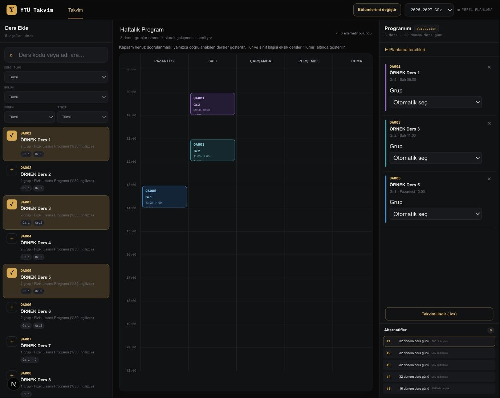
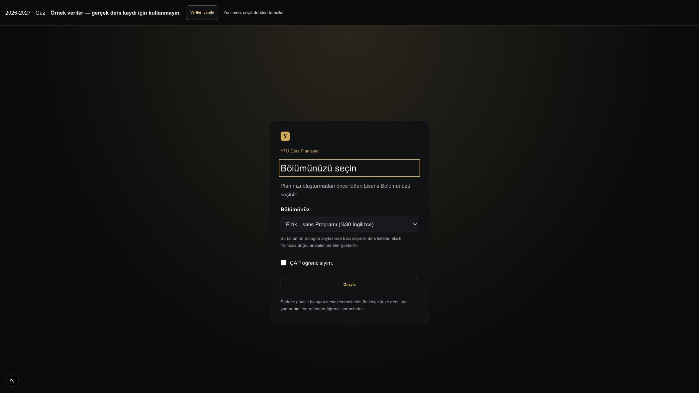

# YTÜ Takvim

**Work in progress**

A course scheduler for Yıldız Technical University students, including double majors.
Choose eligible courses, lock preferred groups, block unavailable hours, and compare
ranked schedules in an interactive weekly calendar.

The project separates **curriculum eligibility** from **term offerings**. Its local
owner tools turn source documents into reviewed, versioned data; the student app
validates that data and searches for compatible schedules entirely in the browser.

> This repository contains application code and invented test examples.
> Screenshots below use synthetic courses only.
> This is an independent student project with no institutional affiliation or endorsement.

## Screenshots

The working interface, running locally with fictional demonstration data:





## What works

- Main-major and optional double-major selection, with remembered preferences.
- Curriculum-based course eligibility and per-major group restrictions.
- Shared-course deduplication and year/course-type filters.
- Browser scheduling: exactly one group per course, retaining all its meetings.
- Group locks, unavailable hours, ranking preferences, bounded search and cancellation.
- Conflict messages naming courses, groups, weekdays and overlapping times.
- Seven-day calendar, including online classes and multiple meetings per group.
- Downloadable ICS calendars with teaching dates and Europe/Istanbul time handling.
- Separate local owner app for document validation, evidence review, immutable drafts,
  revision comparison and validated release exports.
- Bologna catalog ingestion and coverage reporting; student choices follow a reviewed
  YÖK Atlas directory. Directory support does not imply complete timetable coverage.

## Try it locally — synthetic demo

Requires **Node.js 26** and npm. Python, university access and a populated database
are not needed for this demo.

```sh
cd web
npm ci
npm run demo
```

Open [localhost:3000](http://localhost:3000). Choose **Fizik** as your major, confirm,
and add courses labelled **QA001**, **QA003**, and **QA005** to see alternatives.
The fixture includes conflicting options, an unknown-time course and a Sunday meeting.
The example dates and course data are fictional; calendar downloads are test-labelled.

The demo enables test packages only in development, writes an ignored temporary JSON
into `web/public/`, and removes it on normal exit. Stop it with Ctrl-C. After an
unclean shutdown, remove `web/public/demo-student-package.json` before restarting.
Production rejects test packages even if the development opt-in flag is set.

## Architecture

```text
Local owner workflow
  source document → standardized JSON → validation + review → immutable drafts
                                                          → versioned release export

Student workflow
  static student-data JSON → validation → major eligibility → browser solver
                                                          → weekly calendar + ICS
```

| Component | Stack | Responsibility |
| --- | --- | --- |
| `web/` | Next.js 16, React 19, TypeScript | Student dashboard, browser solver, ICS export |
| `api/` | Python 3.13, FastAPI, SQLAlchemy, SQLite, OR-Tools | Catalog ingestion, extraction, review, local exports, legacy solver |
| `local-owner/` | Next.js, React, TypeScript | Local data preparation interface |

The student website can be exported as static files. Owner tools and databases stay
on the maintainer's computer. The Python-backed student planner remains available
for local development; the package-based student experience needs no Python server.

## Example timetable JSON

This **invented** document illustrates the owner interchange format, not a student
release package. Null source hashes and catalog IDs must be resolved during review;
this example is not publishable timetable data.

```json
{
  "schema_version": "1.0",
  "source": {
    "key": "example-department",
    "revision": "example-1",
    "replaces_revision": null,
    "publisher": "Example Department",
    "filename": "example.txt",
    "url": null,
    "sha256": null,
    "published_on": null
  },
  "term": {
    "code": "2026-2027-fall",
    "academic_year": "2026-2027",
    "season": "fall",
    "timezone": "Europe/Istanbul"
  },
  "courses": [{
    "code": "DEM1001",
    "name": "Example Course",
    "catalog_course_id": null,
    "groups": [{
      "label": "Example A",
      "time_status": "scheduled",
      "evidence": { "page": 1, "quote": "Invented example: Tuesday 11:00–12:00" },
      "permissions": {
        "allowed_bologna_program_ids": null,
        "excluded_bologna_program_ids": [],
        "unresolved": false
      },
      "meetings": [{
        "weekday": 2,
        "starts_at": "11:00:00",
        "ends_at": "12:00:00",
        "room": "Example Room",
        "delivery_mode": "in_person",
        "evidence": { "page": 1, "quote": "Invented example: Tuesday 11:00–12:00" }
      }]
    }]
  }],
  "withdraw_all": false,
  "issues": [],
  "ignored_events": []
}
```

See the [JSON schema](docs/schedule-document.schema.json) and
[local owner setup](local-owner/README.md) for the full contract and review tools.
All bundled examples and test timetables are synthetic.

## Develop the local tools

Install [uv](https://docs.astral.sh/uv/) and Python 3.13, then:

```sh
cd api
uv sync --locked --all-groups
uv run uvicorn ytu_scheduler.local_main:app --host 127.0.0.1 --port 8001
```

In another terminal:

```sh
cd local-owner
npm ci
npm run dev
```

Open [localhost:3001](http://localhost:3001). A fresh checkout starts without imported
curricula or schedules. See the [API guide](api/README.md) for catalog preparation.
Do not deploy or reverse-proxy the local owner service.

## Verification

Install dependencies in `api/`, `web/` and `local-owner/` as described above, then run
`make test` from the repository root. It runs backend lint/tests and student
unit tests, lint and type checks, plus owner lint and type checks.

Tests use isolated databases and synthetic timetables. No ignored local data is
required. GitHub Actions runs these checks and a static compilation check on pushes
and pull requests. The build check uses an intentionally absent package URL: it
verifies compilation, not a usable public timetable release.

The production build requires a reviewed package URL and refuses generated local
previews. See the build instructions below. No release data is committed to Git.

## Production build — future release

After preparing and reviewing a real release locally, stop the demo and remove its
generated demo/QA/pilot JSON from `web/public/`. Supply the reviewed student-data URL
at build time:

```sh
cd web
NEXT_PUBLIC_STUDENT_PACKAGE_URL=/data/student-data-<export_id>.json npm run build
```

The output is `web/out/`, served by any static HTTP server. A package URL is embedded
at build time; it must resolve to the intended reviewed data for a usable release.
Never put owner reports, source archives or databases in `public/`. Keep real release
packages out of this source repository. Compilation alone does not establish release
readiness; verify the actual package, scheduling and calendar flow before deployment.

## Remaining work

- Finish browser QA of the latest conflict explanations and narrow-screen flows.
- Complete physical-phone and spoken screen-reader checks.
- Review release source freshness, coverage and officially verified teaching dates.
- Produce a reviewed real package and verify the complete static release flow.
- Configure hosting and perform live checks.

Accounts, calendar account sync, holiday adjustments, saved named plans and image
export are outside the current committed scope. Prerequisites and registration
conditions remain the student's responsibility. Unknown-time groups cannot receive
a verified conflict-free guarantee.

## Documentation

- [Student app setup](web/README.md)
- [API and catalog setup](api/README.md)
- [Local owner tools](local-owner/README.md)
- [Timetable JSON schema](docs/schedule-document.schema.json)
- [Contributing and data policy](CONTRIBUTING.md)
